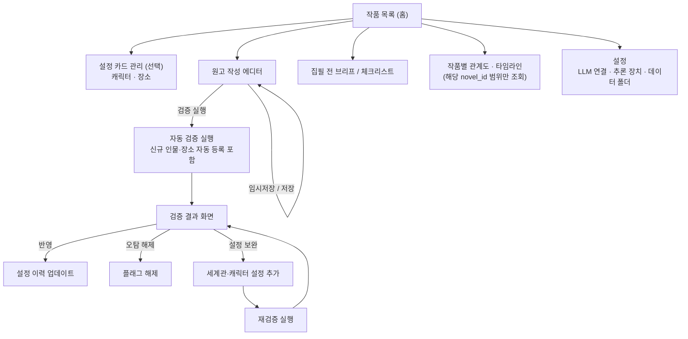
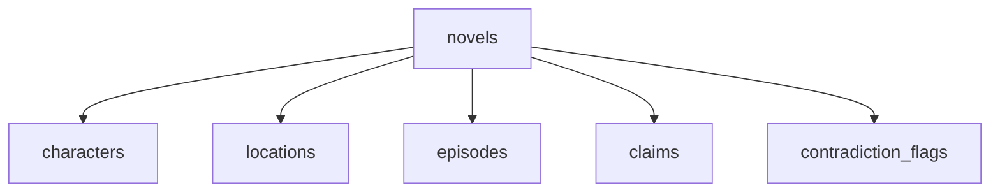
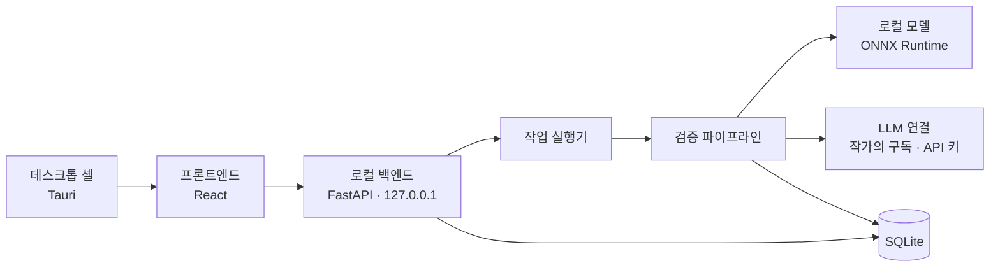
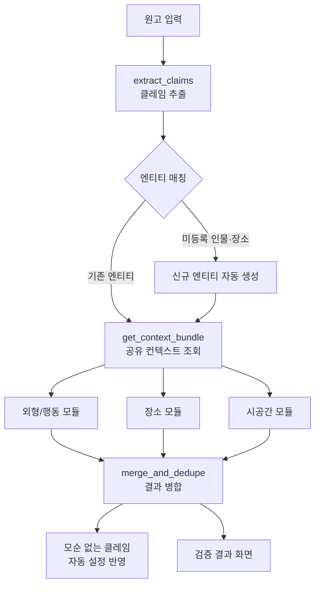
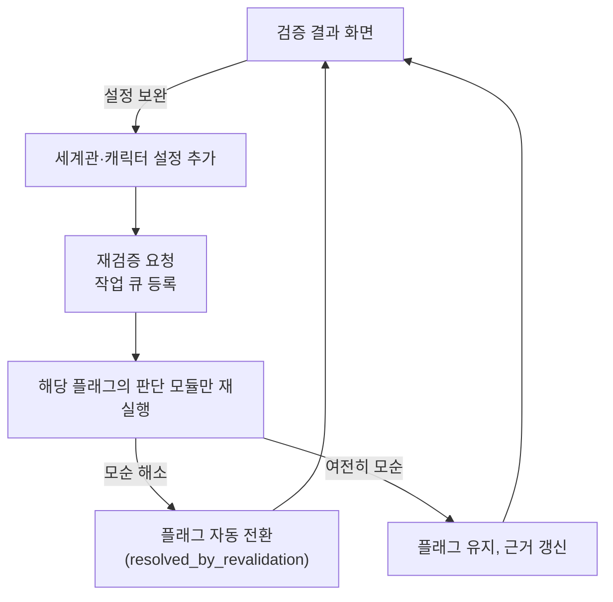
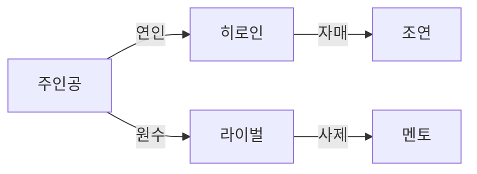
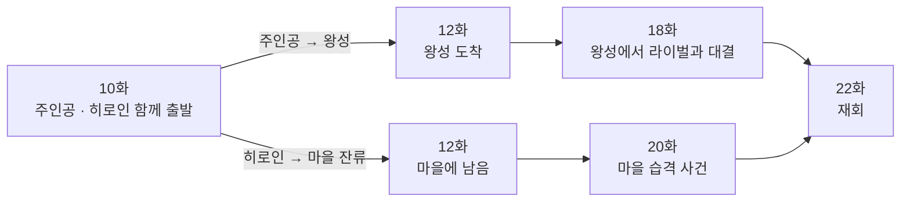
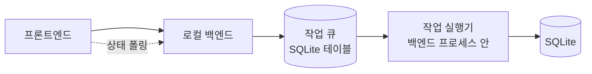
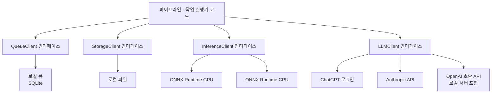

# Retcona

> "Recording Every Timeline Change: Oversight Network, Assistant" — 모든 타임라인 변화를 기록하다: 감독 네트워크, 보조자

웹소설 연재 중 쌓이는 캐릭터·장소·사건 설정을 자동으로 기록하고, 새 원고가 기존 기록과 모순되는지 자동으로 찾아주는 Windows 데스크톱 앱입니다. 원고와 설정은 작가의 PC에만 저장되며, 무료 오픈소스로 배포합니다.

> 아래 내용은 이 프로젝트의 기획 및 설계서입니다. 1부는 무엇을, 왜 만드는지(기획)를, 2부는 그것을 어떻게 만드는지(설계)를 다룹니다.

---

## 1부 · 기획

### 1. 프로젝트 개요

| 항목 | 내용 |
|---|---|
| 프로젝트명 | Retcona |
| 프로젝트명 의미 | 원문: "Recording Every Timeline Change: Oversight Network, Assistant"<br>번역: "모든 타임라인 변화를 기록하다: 감독 네트워크, 보조자" |
| 유형 | 개인 프로젝트 / 무료 오픈소스 Windows 데스크톱 앱 |
| 한 줄 소개 | 웹소설 연재 중 쌓이는 캐릭터·장소·사건 설정을 자동으로 기록하고, 새 원고가 기존 기록과 모순되는지 자동으로 찾아주는 앱 |

### 2. 배경 및 문제 정의

웹소설 연재는 긴 기간에 걸쳐 화(episode) 단위로 이어 쓰는 구조다. 화수가 쌓일수록 작가가 초반에 정한 설정을 스스로 정확히 기억하고 추적하기가 점점 어려워진다.

실제로 자주 발생하는 문제 유형:
- **외형 불일치**: 초반에 정한 캐릭터의 눈 색깔, 흉터 위치 등이 후반부 묘사와 어긋남
- **행동 불일치(OOC)**: 캐릭터의 확립된 성격에 맞지 않는 행동이 서술됨
- **시공간 모순**: 이미 죽은 인물의 재등장, 나이·계절 계산 오류, 이동 거리상 불가능한 동선
- **장소 오류**: 장소 간 거리나 지리적 특징이 이전 서술과 어긋남

작가가 매 화를 쓸 때마다 전체 원고를 다시 읽어 검증하는 것은 화수가 늘어날수록 비효율이 기하급수적으로 커지는 작업이다.

### 3. 핵심 가치 제안

- 작가가 매번 전체 원고를 재검토하지 않아도, 새 화 원고를 입력하는 것만으로 설정 모순을 자동 탐지
- 고정 캐릭터 설정은 미리 입력해도 되고, 입력하지 않으면 원고에 처음 등장하는 순간 자동으로 생성된다 — 이렇게 확보된 설정과, 연재하며 누적되는 가변 기록(사건·위치·관계)을 함께 대조
- 오류를 자동으로 고쳐주는 것이 아니라, 근거 문장과 함께 "발견하여 제시"하는 데 집중 — 최종 판단은 작가가 내림
- 플래그를 확인하다 누락된 설정이 있었다는 걸 알게 되면, 전체를 다시 돌리지 않고 그 항목만 즉시 재검증할 수 있음

### 4. 타겟 사용자

- 장편·연재 웹소설을 집필 중인 개인 작가
- 특히 등장인물이 많고 세계관이 복잡한 장르(판타지, 로맨스판타지, 무협 등)의 작가
- 화수가 많이 쌓여 스스로 설정을 추적하기 어려워진 연재 작가

### 5. 페르소나

#### 페르소나 A — 설정파 작가
| 항목 | 내용 |
|---|---|
| 이름(가상) | 이서연, 27세 |
| 상태 | 로맨스판타지 웹소설 연재 중, 주 3회 연재, 현재 180화 진행 |
| 특징 | 세계관과 등장인물 설정이 방대함. 별도 노트/엑셀에 설정을 정리해왔지만 연재가 길어지며 업데이트가 누락되는 경우가 잦음 |
| Pain Point | 새 화를 쓸 때마다 "이 설정이 예전에 뭐였는지" 확인하려고 과거 화를 다시 검색해서 읽는 데 상당한 시간이 듦. 독자 댓글로 설정 오류를 지적받고 나서야 알아차리는 경우도 있음 |
| Goal | 연재 속도를 유지하면서도 설정 오류로 인한 독자 이탈을 막고 싶음 |

#### 페르소나 B — 즉흥파 작가
| 항목 | 내용 |
|---|---|
| 이름(가상) | 김태민, 24세 |
| 상태 | 첫 장편 연재를 시작한 신인 작가, 판타지 장르, 30화 진행 중 |
| 특징 | 세세한 설정을 미리 다 정하기보다 쓰면서 즉흥적으로 세계관을 확장하는 스타일 |
| Pain Point | 초반에 가볍게 정해둔 설정을 스스로도 기억 못 해서, 이미 쓴 내용과 모순되는 전개를 만들까봐 불안해함 |
| Goal | 최소한의 사전 설정만으로도 이후 집필에서 모순을 방지하고 싶음 |

두 페르소나는 각각 "사전 설정 대조"와 "누적 기록 대조"라는 앱의 두 축과 대응된다 — 설정파는 미리 입력한 고정 설정을 기준으로, 즉흥파는 연재하며 누적된 기록을 기준으로 검증받는 쪽에 더 크게 의존하게 된다.

### 6. 핵심 기능

#### 6.1 작품 관리
가입이나 로그인 없이, 앱을 열면 바로 작품 목록이 나온다. 여러 작품을 등록·관리하고 작품별 인물 관계도·타임라인을 확인한다. 원고와 설정은 모두 작가의 PC에 저장된다.

#### 6.2 앱 내 집필 에디터
장문을 입력할 수 있는 에디터에서 원고를 직접 작성한다. 임시저장과 저장을 지원해 작업 중 내용이 유실되지 않으며, 저장된 원고를 기준으로 검증을 실행한다. 이미 저장한 화도 다시 열어 수정할 수 있다.

#### 6.3 세계관 · 캐릭터 사전 설정 (선택)
집필을 시작하기 전에 세계관(시대적 배경, 마법/무공 체계, 세력·조직, 역사)과 캐릭터(이름, 외형, 성격, 말투 등)를 미리 입력해둘 수 있다. 입력한 내용은 이후 모든 검증의 기준이 되며, 입력하지 않아도 원고를 쓰는 과정에서 자동으로 채워진다.

#### 6.4 캐릭터 설정 대조 (외형 / 행동)
캐릭터 설정 카드(고정 속성 + 가변 속성)는 사전 입력이 선택 사항이다. 입력해두면 그 기준으로, 입력하지 않았다면 원고에 새 인물이 등장할 때 자동 생성된 설정을 기준으로 외형·행동 묘사가 어긋나는지 탐지한다. 모순 없는 새로운 정보는 연재가 진행될수록 자동으로 설정에 쌓인다.

#### 6.5 사건 타임라인 대조
연재 순서(화 번호)와 극중 시간을 각각 기준으로, 캐릭터·장소의 상태 변화 이력과 새 원고 내용이 모순되는지 탐지한다.

#### 6.6 장소 설정 대조
장소의 지리적 특징, 다른 장소와의 거리·연결 관계를 기준으로 장소 묘사 오류나 이동 동선의 모순을 탐지한다.

#### 6.7 인물 관계도 · 스토리 타임라인 자동 생성
누적된 관계·상태 이력 데이터를 바탕으로, 캐릭터 간 인물 관계도와 화/극중 시간 기준 스토리 타임라인을 별도 작업 없이 그래프로 자동 생성해 보여준다. 스토리 타임라인은 단순 시간순 나열이 아니라, 캐릭터·장소에 따라 사건이 갈라지고 다시 합류하는 과정까지 표현한다.

#### 6.8 (부가) 캐릭터 일러스트 생성
입력해둔 캐릭터 설정을 바탕으로 일러스트를 생성하는 기능. 핵심 개연성 엔진과는 별도 모듈로, 우선순위상 후순위로 개발한다.

### 7. 차별점

단순히 설정을 메모·위키 형태로 정리해두는 기존 방식과 달리, 새 원고 입력 시 자동으로 기존 기록과 대조하여 모순 후보를 먼저 찾아 제시한다는 점이 핵심 차별점이다. 작가가 능동적으로 설정을 찾아보는 것이 아니라, 앱이 능동적으로 문제를 제기하는 방향. 설정을 미리 다 채워두지 않아도 원고만으로 바로 시작할 수 있다는 점도 진입장벽을 낮춘다. 또 작가의 PC에서 동작하는 앱이라 미발표 원고가 외부 서버로 나가지 않는다 — 원고를 보내는 것은 작가가 직접 켠 LLM 연결(2부 3장)뿐이다.

### 8. 기대 효과

- 개연성 오류로 인한 독자 이탈 감소
- 설정 관리 및 재검토에 드는 작가의 시간·인지적 부담 감소
- 장기 연재에서도 일관된 세계관·캐릭터 유지 가능

### 9. 향후 확장 방향

- 공동 집필(다인 협업) 환경 지원
- 장르별 특화 설정 스키마 (마법 체계, 무공 체계 등)
- 일러스트 생성의 캐릭터 일관성 고도화
- macOS 지원 (처음에는 Windows만)

---

## 2부 · 설계

### 1. 시스템 개요

- **목적**: 새 화 원고 입력 시, 기존에 누적된 설정·기록과 자동으로 대조하여 개연성 오류 후보를 탐지한다.
- **세 가지 검증 관점**: 외형/행동 위반, 장소 오류, 시공간(타임라인) 모순
- **설계 원칙**: 모듈 경계는 데이터 타입(캐릭터/장소)이 아니라 **판단 관점** 기준으로 나누고, 데이터 조회는 공유 레이어에서 일괄 처리한다. 작가 한 명이 자기 PC에서 쓰는 앱이지만, 모든 데이터는 작품(novel) 단위로 묶어 다른 작품의 설정이 검증에 섞이지 않게 한다.

### 2. UX 설계

#### 2.1 화면 흐름



#### 2.2 원고 작성 에디터 화면

```
+--------------------------------------------------+
|  12화 작성                                        |
+--------------------------------------------------+
|                                                    |
|   (장문 입력 영역)                                  |
|                                                    |
|                                                    |
+--------------------------------------------------+
|  마지막 저장: 2분 전    [임시저장]  [저장]  [검증 실행]|
+--------------------------------------------------+
```

- **임시저장**: 입력이 멈춘 뒤 일정 시간(디바운스) 또는 일정 주기로 자동 실행. AI 파이프라인은 호출하지 않고 원고만 보존
- **저장**: 사용자가 직접 누르는 즉시 저장. 임시저장과 동일하게 AI 파이프라인은 실행하지 않음
- **검증 실행**: 저장된 원고를 10.2의 로컬 작업 큐에 등록해 파이프라인을 실행 — 저장(쓰기)과 검증(AI 처리)을 분리해, 입력할 때마다 불필요한 AI 호출이 발생하지 않도록 한다
- **기존 화 불러오기**: 작품 목록(2.6)의 작품에서 화를 선택해 열면, `draft`·`submitted` 상태와 무관하게 해당 화의 원문이 그대로 로드되어 같은 에디터에서 이어서 수정할 수 있다
- **이미 검증된 화를 수정한 경우**: `status`가 `submitted`인 화를 수정해 저장하면 `status`가 다시 `draft`로 전환된다. 기존 검증 결과(2.4)는 그대로 남아 있되 "원고가 수정되어 최신 상태가 아님" 배너가 표시되며, 재검증은 자동 실행되지 않고 작가가 직접 "검증 실행"을 눌러야 갱신된다 — 저장과 검증을 분리하는 원칙을 수정 시에도 동일하게 유지

#### 2.3 세계관 · 캐릭터 사전 설정 화면

```
+--------------------------------------------------+
|  세계관 설정                        [+ 항목 추가]   |
+--------------------------------------------------+
|  [마법 체계] 오드 마나 시스템                        |
|   마나는 체내에서 생성되며 하루 최대 3회까지만 사용 가능 |
+--------------------------------------------------+
|  [세력] 아스텔 왕국                                 |
|   대륙 동부를 지배하는 왕정 국가 ...                  |
+--------------------------------------------------+
```

```
+--------------------------------------------------+
|  캐릭터 설정 — 이서하                     [저장]     |
+--------------------------------------------------+
|  고정 속성                                         |
|   이름 · 나이 · 눈 색깔 · 머리색 · 신장 · 흉터 · 출신  |
+--------------------------------------------------+
|  가변 속성                                         |
|   헤어스타일 · 복장 · 부상/건강 상태 · 소지품          |
+--------------------------------------------------+
|  성격 · 말투                                       |
|   성격 키워드 · 말투 특징 · 목표/가치관               |
+--------------------------------------------------+
```

- 세계관은 카테고리(시대적 배경/마법·무공 체계/세력·조직/역사/기타 규칙) + 제목 + 자유 서술 형태로 입력
- 캐릭터는 고정 속성 / 가변 속성 / 성격·말투 세 구획으로 입력 — 성격·말투는 OOC(행동 불일치) 판단에 쓰임
- 모두 선택 입력이며, 비워두면 2.2 에디터로 작성한 원고에서 자동으로 채워짐(7.4 참고)

#### 2.4 핵심 화면 — 검증 결과 화면 레이아웃

```
+-------------------------+--------------------------+
|                         |  ⚠ 모순 후보 (3)           |
|      원고 본문           |  ① 외형 불일치              |
|   (모순 구간 하이라이트)  |     근거 → 3화 "파란 눈"    |
|                         |  ② 장소 오류                |
|                         |  ③ 타임라인 모순             |
+-------------------------+--------------------------+
```

원문과 플래그를 좌우로 배치해 근거 문장을 바로 대조할 수 있게 한다. 각 플래그에는 "반영" · "오탐 해제" 외에 "설정 보완 후 재검증" 액션이 있어, 세계관·캐릭터 설정을 추가로 입력하고 그 자리에서 다시 검증할 수 있다.

#### 2.5 설계 원칙

- 캐릭터·장소 설정 사전 입력은 선택 사항 — 입력하지 않은 인물/장소는 원고에 처음 등장할 때 자동 생성됨
- 모순 없는 새로운 정보는 자동으로 설정에 반영되지만, 기존 설정과 모순되는 정보는 자동 수정 없이 항상 "제시 + 작가 확인" 구조를 따름 (상세는 7.4 참고)
- 모순 플래그는 설정을 보완해 재검증하면 해소될 수 있음 — 전체 재검증이 아니라 해당 플래그만 다시 판단 (상세는 7.5 참고)
- 플래그는 신뢰도순 정렬, 근거 문장 클릭 시 원문 위치로 이동

#### 2.6 작품 목록 · 설정 화면

```
+--------------------------------------------------+
|  내 작품                    [+ 새 작품]  [⚙ 설정]   |
+--------------------------------------------------+
|   이계의 검사        42화   수정: 2일 전             |
|                     [열기] [관계도·타임라인] [삭제]  |
|   왕좌의 유산        12화   수정: 1주 전             |
|                     [열기] [관계도·타임라인] [삭제]  |
+--------------------------------------------------+
|   휴지통 (1)                                        |
+--------------------------------------------------+
```

```
+--------------------------------------------------+
|  설정                                              |
+--------------------------------------------------+
|  LLM 연결 (OOC 판단, 선택)                          |
|   연결됨: ChatGPT (Plus)          [변경] [연결 해제]  |
+--------------------------------------------------+
|  추론 장치    ◉ 자동 (GPU 우선)  ○ CPU만             |
|  데이터 폴더  C:\Users\...\Retcona     [열기] [백업] |
+--------------------------------------------------+
|  정보 · 오픈소스 라이선스 · 모델 출처                  |
+--------------------------------------------------+
```

- 앱을 열면 처음 보이는 화면이 작품 목록이다 — 계정이 없으므로 로그인·가입·탈퇴 화면은 없다
- **내 작품 관리**: 작품 목록에서 제목 변경, 열기(화 목록 → 기존 화 선택 시 2.2 에디터로 이동, 새 화도 여기서 시작), 삭제 가능
- **관계도·타임라인 보기**: 작품별로 8장에서 설계한 인물 관계도·스토리 타임라인 그래프를 확인하는 화면으로 이동 (아래 2.7 참고)
- **작품 삭제**: 확인 모달 후 휴지통으로(30일 보관, 기간 내 복구 가능) → 기간이 지나면 앱이 실행 중일 때 해당 `novel_id`에 속한 모든 데이터를 영구 삭제 — 4.1의 작품 단위 구조 덕분에 `novel_id` 하나로 모든 하위 데이터가 연결돼 있어 삭제 범위가 명확함
- **설정**: LLM 연결(3장), 추론 장치(10.3), 데이터 폴더 열기·백업(10.1), 앱 정보와 오픈소스 라이선스·모델 학습 데이터 출처(10.5.2)

#### 2.7 작품별 관계도 · 타임라인 화면

```
+--------------------------------------------------+
|  이계의 검사 — 관계도 · 타임라인   [관계도][타임라인] |
+--------------------------------------------------+
|                                                    |
|          (8.2/8.3의 그래프를 이 영역에 렌더링)         |
|                                                    |
+--------------------------------------------------+
```

- 작품 목록(2.6)에서 진입 — 조회는 항상 그 작품의 `novel_id` 범위로 한정됨(10.1)
- 상단 탭으로 인물 관계도(8.2)와 스토리 타임라인 그래프(8.3)를 전환 — 8.4에서 설계한 동일한 그래프 컴포넌트를 재사용하므로 화면은 하나, 데이터만 다르게 바인딩됨

### 3. LLM 연결 (OOC 판단용, 선택)

LLM은 OOC 행동 판단에서 규칙·NLI로 거르고 남은 애매한 경우에만 쓴다(7.2). 앱이 LLM을 내장하거나 요금을 대신 내지 않고, 작가가 쓰고 있는 LLM을 직접 연결한다. 연결하지 않아도 클레임 추출과 외형·장소·시공간 판정은 PC 안의 모델로 모두 동작하고, OOC 판단의 LLM 단계만 꺼진다.

#### 3.1 연결 방식

| 방식 | 대상 | 비고 |
|---|---|---|
| ChatGPT로 로그인 | ChatGPT Go · Plus · Pro 구독 | OpenAI "Sign in with ChatGPT"의 구독 사용량 권한 — API 키나 별도 결제 없이 구독에 포함된 사용량에서 차감. OpenAI가 오픈소스·로컬 실행 앱에 허용. 요청은 Responses API로 보냄 |
| API 키 | Anthropic, OpenAI 호환(OpenAI · Google Gemini · Groq · OpenRouter 등) | 작가가 각 업체의 개발자 콘솔에서 발급. 채팅 구독과는 별개로, 쓴 만큼 결제 |
| 로컬 서버 | Ollama, LM Studio 등 OpenAI 호환 서버 | 원고가 PC 밖으로 나가지 않음. GPU 사양에 따라 품질·속도가 크게 달라짐 |

- Claude와 Gemini의 채팅 구독은 각 업체 약관상 다른 앱에서 쓸 수 없다(2026년 기준) — 이 둘은 API 키로만 연결한다
- 구현은 어댑터 두 종류: Anthropic Messages API, OpenAI 호환(Responses API 기준 — ChatGPT 로그인도 같은 어댑터를 씀)
- 모델은 작가가 고르고, 앱은 연결별 권장 모델만 안내한다

#### 3.2 키·토큰 보관

- API 키와 ChatGPT 로그인 토큰은 Windows 자격 증명 관리자에 저장 — DB·설정 파일에 평문으로 두지 않는다
- 키는 해당 업체로 보내는 요청에만 쓰이고, 앱 밖 다른 곳으로 전송되지 않는다

#### 3.3 원고 전송 고지와 동의

- LLM 연결을 처음 켤 때 "OOC 판단에 원고 일부(해당 문단, 캐릭터의 성격·말투 설정)가 ○○로 전송된다"고 알리고 동의를 받는다
- 입력을 학습에 쓰는 무료 등급(예: Gemini API 무료 등급 — 입력이 모델 개선에 쓰이고 사람이 검토할 수 있음)은 따로 경고한다

#### 3.4 호출 관리

- 한 화의 OOC 후보를 묶어 호출 수를 줄이고, 동시 호출 수 제한과 재시도 대기로 분당 한도를 넘지 않게 한다
- 한도 초과(429)·인증 만료 등으로 실패하면 그 판정만 "OOC 미판정"으로 표시하고 나머지 검증 결과는 그대로 보여준다 — 나중에 다시 시도할 수 있다
- 작가가 어떤 모델을 쓸지 모르므로, 응답 형식을 JSON으로 고정하고 형식이 깨지면 판단하지 않은 것으로 처리한다

### 4. 데이터 모델

#### 4.1 작품 단위 구조

계정이 없는 단일 사용자 앱이므로 `users` 테이블은 없고, 작품(novel)이 최상위다. 모든 데이터를 **작품 단위로 묶어**, 다른 작품의 설정이 검증에 섞이지 않게 하고 삭제·내보내기 범위를 `novel_id` 하나로 정한다.



- **novels**: 작품 정보 (id, title, created_at, `deleted_at` — 휴지통으로 옮긴 시각, 2.6의 작품 삭제 기능에서 사용)
- 아래 모든 엔티티 테이블은 `novel_id` FK를 가지며, 모든 조회·쓰기 쿼리는 반드시 `novel_id`로 필터링한다 (애플리케이션 레이어에서 강제)

#### 4.2 시간 축 이원화

연재 순서와 극중 시간은 다르며, 회상 화 등에서 둘이 어긋날 수 있으므로 반드시 분리 관리한다.

| 축 | 의미 | 용도 |
|---|---|---|
| `episode_index` | 연재 순서 (몇 화인가) | 작가가 지금까지 확정한 사실 누적 순서 — 외형/설정 모순 검사 기준 |
| `story_timestamp` | 극중 시간 (극중 며칠째인가) | 이동 거리·나이·계절 등 물리적 개연성 검사 기준 |

#### 4.3 테이블 구조

(아래 테이블은 모두 `novel_id` FK 보유)

- **characters**: 캐릭터 설정 카드. 고정 속성(이름·나이·눈 색깔·머리색·신장·흉터·출신)과 가변 속성(헤어스타일·복장·부상/건강 상태·소지품), 성격·말투(OOC 판단용)를 구분 저장. `source`(manual/auto_detected)로 작가 직접 입력인지 원고에서 자동 생성됐는지 구분
- **character_state_history**: `episode_index`, `story_timestamp` 기준 캐릭터 상태 변화 로그
- **locations**: 장소 설정 카드 (지리적 특징, 타 장소와의 거리·연결 관계). `source`(manual/auto_detected) 동일하게 보유
- **world_settings**: 세계관 설정 카드 (category: 시대적 배경/마법·무공 체계/세력·조직/역사/기타 규칙, title, content 자유 서술)
- **location_state_history**: 장소 상태 변화 로그
- **relations**: 인물 간 관계, 장소 간 거리/연결 정보
- **episodes**: 화별 원고 원문 + 임베딩. `status`(draft/submitted)로 작성 중/검증 요청 상태를 구분하고, 자동저장 시각(`updated_at`)을 기록. `submitted` 화를 수정하면 `status`가 다시 `draft`로 전환됨(2.2 참고)
- **claims**: 원고에서 추출한 검증 대상 주장 단위
- **contradiction_flags**: 오류 유형, 신뢰도, 근거 문장, `status`(open/resolved_by_revalidation/accepted/dismissed)
- **story_events**: 사건 노드 (id, episode_index, story_timestamp, title/요약) — 스토리 타임라인 그래프의 노드
- **event_participants**: 사건에 참여한 캐릭터 (event_id, character_id)
- **event_locations**: 사건이 일어난 장소 (event_id, location_id)
- **event_links**: 사건 간 연결 (from_event_id, to_event_id, link_type: 순차/분기/합류, branch_reason: 분기를 일으킨 캐릭터·장소)

#### 4.4 인덱스

- `(novel_id, entity_id, episode_index)` 복합 인덱스
- `(novel_id, entity_id, story_timestamp)` 복합 인덱스
- `(novel_id, from_event_id)`, `(novel_id, to_event_id)` 복합 인덱스 — 사건 그래프 순회용
- `novel_id`를 선두 컬럼으로 두어, 조회가 항상 해당 작품 범위로 좁혀지도록 한다

### 5. AI / 기술 스택

| 구성 요소 | 선택 | 비고 |
|---|---|---|
| 앱 셸 | Tauri 2 + React 프론트엔드 | Windows의 WebView2를 써서 설치 파일이 작음. 설치·업데이트도 담당 |
| 로컬 백엔드 | FastAPI (PyInstaller로 묶어 셸이 실행) | 127.0.0.1에서만 대기 (10.4.2) |
| 추론 런타임 | ONNX Runtime — GPU(DirectML), 없으면 CPU | NVIDIA·AMD·인텔 GPU 모두 지원. 학습은 `ml/`에서 PyTorch로 하고 ONNX로 내보냄 — 앱에 PyTorch를 넣지 않음 |
| 형태소 분석 | kiwipiepy | 추출 규칙의 품사 태그 (7.1.1) |
| 임베딩 | KURE-v1 + BM25 하이브리드 | 의미 기반 검색과 키워드 매칭을 함께 사용 |
| Cross-encoder 리랭커 | bge-reranker-v2-m3-ko 계열 | 관련 과거 설정 문장 Top-K 추출용 |
| NLI | klue-roberta + KorNLI 기반 | 소설 서술체/대사체 도메인으로 재파인튜닝 필요 |
| 개체명 인식(NER) | klue-roberta를 직접 학습 | 클레임 추출 — 원고에서 인물·장소 이름 찾기 (7.1.1) |
| 추출형 질의응답 | klue-roberta를 직접 학습 | 클레임 추출 — 문장에서 속성 값 뽑기 (7.1.1) |
| LLM | 작가가 연결한 LLM (3장) | **OOC 행동 판단에만, 선택적으로 사용** — 규칙·NLI로 거르고 남은 애매한 경우 (7.2) |
| DB | SQLite (벡터 검색은 sqlite-vec) | 작가 PC의 파일 하나 — 따로 설치·실행할 DB 서버가 없음 |

임베딩·리랭커는 크기가 커서(KURE-v1은 약 5.7억 파라미터) 앱에 넣을지, 넣는다면 GPU가 있을 때만 쓸지를 구현할 때 정한다.

### 6. 코드 구조

#### 6.1 아키텍처



#### 6.2 폴더 구조

```
retcona/
├── desktop/           # Tauri 셸 — 백엔드 프로세스 실행, 설치 파일 · 업데이트
├── frontend/          # 작품 목록, 설정 카드, 에디터, 검증 결과 화면
├── backend/
│   ├── api/            # REST 엔드포인트 (셸 안의 프론트엔드만 호출)
│   ├── pipeline/         # extract_claims, context_bundle, 판단 모듈 3종, merge
│   ├── models/            # DB 모델 (novels, characters, locations ...)
│   ├── ai/                 # 임베딩 · 리랭커 · NLI · LLM 클라이언트 래퍼
│   ├── workers/              # 로컬 작업 실행기 (검증 · 재검증 · 휴지통 비우기)
│   └── infra/                  # 작업 큐 · 추론 · LLM · 저장소 인터페이스와 구현체
├── ml/                # 모델 학습 · 평가 (PyTorch), ONNX 내보내기
└── db/                # 마이그레이션 · 스키마
```

- `pipeline/` 내 3개 판단 모듈은 동일 인터페이스(`claims + context_bundle` 입력 → `flags` 출력)를 공유해 병렬 실행과 모듈 교체가 용이함
- 모든 `models/`, `pipeline/` 함수는 `novel_id`를 필수 인자로 받도록 설계해, 작품 간 섞임을 코드 레벨에서 차단
- `pipeline/`과 `ai/`는 비즈니스 로직만 담고, 큐·추론·LLM·저장소 접근은 항상 `infra/`의 인터페이스를 거침 — 10.4.3 참고

### 7. 파이프라인 설계

#### 7.1 처리 흐름



#### 7.1.1 클레임 추출 (LLM 없이)

LLM은 OOC 판단에만 쓰고(7.2), 클레임 추출은 직접 학습한 소형 모델과 규칙으로 한다 — 호출량 대부분을 차지하는 단계라 비용을 없애고, 로컬에서도 돌릴 수 있게 하기 위함.

1. **문장 분리**: 원고를 문장 단위로 나누고, 따옴표 안의 대사는 따로 표시
2. **인물·장소 찾기**: 등록된 이름·별칭과의 문자열 매칭 + 개체명 인식(NER) 모델로 등록되지 않은 이름 발견
3. **속성 단서**: 속성별 단서어("눈동자"·"머리카락"·"흉터"·"살"·"출신" 등)가 있는 문장만 후보로
4. **속성 값**: 추출형 질의응답 모델로 문장에서 값을 뽑음 (예: "레온의 눈 색깔은?" → "푸른색")
5. **대명사·주어 생략**: 규칙으로 처리 — 같은 문장과 앞 2~3문장에 나온 인물 중, 성별이 맞는 후보가 **한 명일 때만** 연결하고 애매하면 건너뜀(잘못 연결해 엉뚱한 카드와 비교하는 것보다 놓치는 쪽이 덜 해로움). 판정 때는 이름이 나온 앞 문장을 함께 넘겨 NLI가 문맥을 읽게 함. 이를 위해 캐릭터 카드에 성별 항목을 둠
6. **동명이인**: 문맥으로 구분하지 않음 — 원고에 별칭이 쓰였으면 그 카드로, 이름만으로는 여러 카드에 해당하면 연결하지 않음(7.4)

대명사 처리가 부족하다고 확인되면, 상호참조 말뭉치로 학습한 모델을 추가로 검토한다.

#### 7.2 모듈별 설계

| 모듈 | 주요 입력 필드 | 판단 방식 |
|---|---|---|
| 외형/행동 위반 | `fixed_attrs`, `latest_mutable_state`, `personality`, `world_settings` | 외형: NLI / 행동(OOC): 말투(존댓말·반말 등)는 규칙, 성격 서술과의 모순은 NLI로 먼저 거르고, 남은 애매한 경우만 LLM + 성격·말투 프로파일과 세계관 규칙 기반 추론 |
| 장소 오류 | `fixed_attrs`(지형), `relations`(거리) | NLI + 규칙 기반 거리 계산 |
| 시공간 모순 | `last_known_position`, `state_history`, `relations` | 규칙 기반 시간·거리 검증 |

NLI가 애매하게 본 모순을 LLM으로 다시 판단하는 단계는 두지 않는다 — 최종 판단은 작가가 한다(반영·오탐 해제). 쌓이는 오탐 해제 기록으로 NLI의 모순 기준값을 조정한다.

#### 7.3 병렬화 시 고려사항

- 컨텍스트 사일로 방지: 세 모듈이 공유 번들을 통해 필요한 정보에 모두 접근
- 결과 병합 필수: 동일 원인 오류의 중복 탐지 제거
- 자원 관리: 작가 PC의 GPU 메모리를 넘지 않도록 검증 작업은 한 번에 하나씩, 모델 추론은 문장을 묶어서(10.3). LLM은 작가 계정의 한도 안에서(3.4)

#### 7.4 신규 엔티티 자동 등록 및 설정 자동 반영

- **엔티티 매칭**: 클레임의 인물·장소명을 기존 `characters`/`locations`와 이름·별칭 기준으로 매칭 (문자열 매칭 + 임베딩 유사도로 별칭 처리)
- **신규 등록**: 매칭되는 엔티티가 없으면 `source: auto_detected`로 새 레코드를 자동 생성하고, 첫 언급 내용을 초기 고정 속성으로 저장 — 작가가 사전에 입력하지 않은 인물·장소도 원고만으로 설정 카드가 만들어짐
- **자동 반영**: 모순으로 플래그되지 않은 클레임은 `character_state_history`/`location_state_history`에 자동으로 누적되어, 연재가 진행될수록 설정 카드가 스스로 채워짐
- 모순으로 플래그된 클레임만 2.5의 원칙대로 작가 확인 후 반영 — 자동 반영은 "새로운 정보 추가"에 한정되고, "기존 설정 수정"은 항상 작가 확인을 거침

#### 7.5 설정 보완 후 재검증

작가가 플래그를 보고 "사실 이건 세계관 규칙 때문에 맞는 서술"이라고 판단할 수도 있다 — 이 경우 누락됐던 설정을 추가하고 그 플래그만 다시 검증한다.



- 전체 파이프라인을 다시 돌리지 않고, 플래그를 발생시킨 판단 모듈만 새 컨텍스트 번들로 재실행 — 비용 절감
- 재검증도 10.2의 로컬 작업 큐를 거쳐 비동기로 처리
- 재검증으로 해소된 플래그는 근거(어떤 설정이 추가되어 해소됐는지)를 함께 남겨, 이후 같은 유형의 오탐을 줄이는 데 참고할 수 있게 한다

### 8. 인물 관계도 · 스토리 타임라인 시각화

#### 8.1 데이터 소스

- **인물 관계도**: `relations` 테이블을 조회해 그래프로 렌더링. 관계의 유형·방향성을 명시하기 위해 `relation_type`(가족/연인/원수 등), `direction` 컬럼 보강
- **스토리 타임라인 그래프**: `story_events` + `event_participants` + `event_locations` + `event_links`를 조회해 그래프로 렌더링. 사건을 노드로, 사건 간 연결을 엣지로 사용해야 분기·합류를 표현할 수 있으므로, 캐릭터·장소별 상태 로그만으로는 부족하고 사건 단위 테이블이 별도로 필요하다.
- `event_links`는 작가가 직접 다음 사건을 지정하거나, extract_claims 단계에서 사건 클레임(참여 캐릭터·장소·화)을 추출해 연결을 제안하는 반자동 방식으로 생성한다 — 이 역시 "제시 + 작가 확인" 원칙을 따른다.

#### 8.2 인물 관계도

캐릭터를 노드로, `relations`를 엣지로 하는 관계 그래프. 엣지 라벨 = 관계 유형, 방향성 있는 관계는 화살표로 표시.



#### 8.3 스토리 타임라인 그래프

`story_events`를 노드로, `event_links`를 엣지로 하는 그래프. 한 사건에 참여한 캐릭터·장소가 이후 갈라지면 분기, 서로 다른 사건이 같은 사건으로 이어지면 합류로 표현된다.



위 예시에서 10화 사건은 "주인공은 왕성으로, 히로인은 마을에 남는" 캐릭터·장소 기준 분기이며, 18화·20화의 서로 다른 사건 흐름은 22화 재회에서 합류한다.

#### 8.4 구현 방식

- 관계도·타임라인 모두 노드/엣지 구조이므로 프론트엔드에서 동일한 force-graph / D3.js 계열 그래프 컴포넌트를 재사용해 렌더링
- 화면 진입 시 로컬 백엔드가 해당 `novel_id` 범위의 관계·사건·연결 데이터를 조회해 그래프용 노드/엣지 JSON으로 반환
- 진입 경로는 2.6의 작품 목록 — 별도 메뉴가 아니라 "내 작품" 목록에서 작품을 고른 다음 보는 것으로 통일

### 9. 추가 모듈: 캐릭터 일러스트 생성

- 핵심 개연성 엔진과 분리된 독립 모듈
- 캐릭터 설정 카드의 고정 외형 속성 → 프롬프트 변환 → 작가가 연결한 이미지 생성 API 호출 (LLM과 같은 방식으로 작가가 직접 연결, 3장)
- 핵심 과제: 생성마다 동일 캐릭터로 인식되는 시각적 일관성 확보 (참조 이미지 기반 생성, 캐릭터 LoRA 학습 등 검토 필요)
- 개발 우선순위는 후순위

### 10. 실행 구조와 배포 (Windows 데스크톱 앱)

작가 한 명이 자기 PC에서 쓰는 무료 오픈소스 앱으로 배포한다. 서버가 없으므로 원고와 설정은 PC 밖으로 나가지 않는다 — 예외는 작가가 직접 켠 LLM 연결(3장)과, 모델 다운로드·업데이트 확인(10.5)뿐이다.

#### 10.1 데이터 보관과 작품 단위 격리

- 데이터는 `%LOCALAPPDATA%\Retcona`의 SQLite 파일 하나에 저장한다
- 모든 조회·쓰기는 `novel_id` 필터를 강제한다 (리포지토리 함수가 `novel_id`를 필수 인자로 받도록 설계) — 다른 작품의 설정이 검증·검색에 섞이지 않도록. 벡터 유사도 검색도 반드시 `novel_id` 조건과 함께 수행한다
- 백업: 설정 화면(2.6)에서 DB 파일 전체를 백업하고, 작품 하나를 파일로 내보내거나 가져올 수 있게 한다

#### 10.2 검증 작업 실행 — 로컬 작업 큐

검증 요청은 즉시 처리하지 않고 비동기 작업으로 큐에 등록한다.



- 검증 실행·재검증·휴지통 비우기를 큐에 등록하고, 백엔드 프로세스 안의 작업 실행기가 하나씩 처리한다 — Redis 같은 별도 서버 없이 DB 테이블로 큐를 만들어, 앱을 껐다 켜도 대기 중인 작업이 남는다
- 원고 작성 에디터(2.2)의 "검증 실행" 버튼이 이 큐에 작업을 등록하는 진입점이고, 화면은 상태를 폴링한다
- 한 번에 한 작업만 처리해 GPU 메모리를 넘지 않게 한다

#### 10.3 로컬 자원 관리

- **추론 장치**: GPU가 있으면 ONNX Runtime의 GPU 실행(DirectML)을 쓰고, GPU가 없거나 실패하면 CPU로 돌린다 — 설정(2.6)에서 CPU만 쓰도록 고를 수도 있다. NER·QA·NLI는 1억 파라미터급이라 CPU로도 실용적인 속도가 나온다
- **모델 적재**: 처음 쓸 때 불러와 앱이 켜져 있는 동안 유지하고, 문장을 묶어(batch) 추론한다
- **LLM**: 작가 계정의 한도 안에서 호출한다(3.4)

#### 10.4 앱 구성

##### 10.4.1 실행 단위

| 구성 | 역할 |
|---|---|
| 데스크톱 셸 (Tauri) | 창, 로컬 백엔드 프로세스 실행·종료, 설치·업데이트 |
| 로컬 백엔드 (FastAPI) | API + 작업 실행기(10.2) + 모델 추론 |
| 프론트엔드 (React) | 셸의 WebView에서 표시 |

##### 10.4.2 로컬 백엔드 보호

- 127.0.0.1의 임의 포트에만 바인딩하고, 셸이 실행할 때마다 만든 비밀값을 모든 요청에서 확인한다 — 같은 PC의 다른 프로그램이나 브라우저의 웹페이지가 API를 호출하지 못하게. DNS 리바인딩에 대비해 Host 헤더도 검사한다

##### 10.4.3 코드 설계 — 인터페이스 추상화

추론 장치(GPU↔CPU)와 LLM 연결 방식(3.1)을 작가가 바꿔도 비즈니스 로직이 바뀌지 않도록, 큐·저장소·추론·LLM 접근을 인터페이스 뒤로 감춘다.



- `QueueClient`는 `enqueue(job)` / `dequeue()` / `ack(job_id)` 세 메서드만 노출 — 비즈니스 로직은 이 인터페이스만 사용하고 구현체를 알지 못함
- `StorageClient`는 일러스트 이미지 등을 데이터 폴더(10.1)에 저장
- `InferenceClient`(NLI·NER·질의응답·리랭커)와 `LLMClient`도 같은 패턴 — 설정 화면에서 고른 추론 장치와 LLM 연결에 따라 구현체가 정해진다. 7장의 판단 모듈은 인터페이스만 호출한다
- 같은 인터페이스의 구현체들(GPU/CPU, 각 LLM 어댑터)에 같은 테스트를 돌린다

##### 10.4.4 작업 요구사항

- **무상태**: 작업 실행기는 job payload와 DB 조회만으로 작업을 완결한다
- **멱등성**: 모든 job에 고유 ID를 부여하고 처리 완료 여부를 DB에 기록 — 같은 job이 두 번 실행돼도 결과가 달라지지 않게 한다
- **중단 복구**: 작업 도중 앱이 꺼지면, 처리 중이던 작업은 다음 실행 때 다시 큐로 돌아간다

#### 10.5 배포와 업데이트

##### 10.5.1 설치 파일

- Tauri 번들러로 만든 Windows 설치 파일을 GitHub Releases에 올린다
- 설치 파일에는 앱과 로컬 백엔드만 넣고, 모델은 처음 실행할 때 받는다(10.5.2) — 설치 파일을 작게 유지하고, 모델만 따로 갱신할 수 있게
- 코드 서명이 없으면 Windows SmartScreen 경고가 뜬다 — 서명 방법은 출시 전 체크리스트에서 정한다

##### 10.5.2 모델 배포와 출처 표기

- NER·질의응답·NLI 모델을 ONNX로 내보내 공개 Hugging Face 저장소에 올리고, 첫 실행 때 받아 SHA-256으로 확인한다. 앱 버전마다 받을 모델 버전을 고정한다
- 학습 데이터(KLUE, KorNLI)가 CC BY-SA 4.0이므로 모델도 CC BY-SA 4.0으로 배포하고, 출처를 모델 카드와 앱의 정보 화면(2.6)에 표기한다

##### 10.5.3 업데이트와 네트워크 사용

- Tauri 업데이터로 GitHub Releases의 새 버전을 확인하고, 서명된 업데이트만 설치한다
- 그 밖에 앱이 스스로 보내는 데이터(사용 통계 등)는 없다 — 오탐 해제 기록으로 NLI 기준값을 조정하는 일(7.2)도 PC 안에서만 한다

##### 10.5.4 DB 스키마 마이그레이션

- 스키마 마이그레이션 도구(Alembic)를 그대로 쓰고, 앱이 시작할 때 최신 스키마로 올린다 — 올리기 전에 DB 파일을 백업해 실패하면 되돌린다
- SQLite는 `ALTER TABLE`이 제한적이라 Alembic의 batch 모드로 마이그레이션을 작성한다

### 11. MVP 로드맵

| 단계 | 내용 |
|---|---|
| 1단계 | 작품 관리 + 원고 작성 에디터(임시저장/저장) + 화 단위 엔티티 추출, 작품 단위 설정 카드 스키마 설계 (웹 서비스로 만든 로그인·회원 탈퇴는 6단계에서 제거) |
| 2단계 | 외형 불일치 + 장소 모순 탐지 (NLI 기반) |
| 3단계 | 설정 보완 후 재검증 (플래그 단위 재판단) |
| 4단계 | 사건 타임라인 대조 (상태 이력 누적 로직) |
| 5단계 | OOC 행동 탐지 (규칙·NLI + 작가가 연결한 LLM, 3장) |
| 6단계 | 데스크톱 앱 전환 — 계정 기능 제거, 로컬 작업 큐, SQLite, ONNX Runtime(GPU/CPU), 모델 첫 실행 다운로드, 설치 파일·업데이트 (10장) |
| 7단계 | 인물 관계도 · 스토리 타임라인 시각화 |
| 8단계 (선택) | 캐릭터 일러스트 생성 |

6단계는 5단계보다 먼저 해도 된다 — LLM 연결(3장)의 키 보관과 설정 화면이 단일 사용자 데스크톱 앱을 전제로 하기 때문이다.

---

## 로드맵

GitHub에서는 아래 각 단계를 Milestone으로 만들고, 세부 작업을 Issue로 쪼개 해당 Milestone에 연결하는 방식을 권장합니다.

- [x] **1단계** — 작품 관리 + 원고 작성 에디터(임시저장/저장) + 화 단위 엔티티 추출, 작품 단위 설정 카드 스키마 설계
- [x] **2단계** — 외형 불일치 + 장소 모순 탐지 (NLI 기반)
- [x] **3단계** — 설정 보완 후 재검증 (플래그 단위 재판단)
- [ ] **4단계** — 사건 타임라인 대조 (상태 이력 누적 로직) — 죽은 인물의 재등장, 장소 상태 변화까지 진행
- [ ] **5단계** — OOC 행동 탐지 (규칙·NLI + 작가가 연결한 LLM)
- [ ] **6단계** — 데스크톱 앱 전환 (계정 기능 제거, 로컬 작업 큐, SQLite, ONNX Runtime, 설치 파일·업데이트)
- [ ] **7단계** — 인물 관계도 · 스토리 타임라인 시각화 — 관계·사건 입력과 그래프 화면(1단계)까지 진행
- [ ] **8단계 (선택)** — 캐릭터 일러스트 생성

각 단계의 상세 내용은 위 [2부 · 설계 11. MVP 로드맵](#11-mvp-로드맵) 및 관련 섹션을 참고하세요.

첫 공개 배포 전에 처리할 항목(코드 라이선스, 모델 공개와 학습 데이터 출처 표기, LLM 연결 방식별 약관 확인, 설치 파일 서명과 업데이트 키, GPU별 동작 확인)은 [docs/pre-launch-checklist.md](docs/pre-launch-checklist.md)에 정리되어 있습니다.

## 라이선스

오픈소스로 공개합니다. 코드 라이선스는 아직 정하지 않았습니다(정하면 `LICENSE` 파일 추가 — [출시 전 체크리스트](docs/pre-launch-checklist.md) 1). 배포하는 모델은 학습 데이터를 따라 CC BY-SA 4.0입니다(2부 10.5.2).
